<div align="center">


<br/>


[](https://www.linkedin.com/in/SEU-USUARIO)
[](mailto:johnataichigo56@gmail.com)
[](https://johnataa.vercel.app)

</div>


```text
┌──(root㉿kctxdev)-[~]
└─# cat /etc/motd
   "Segurança não é um recurso. É a fundação."
   // mantenha o menor privilégio. assuma o vazamento. automatize a resposta.
```

Projeto e automatizo infraestrutura em nuvem em que **segurança, auditoria e custo são requisitos de arquitetura**, aplicando *Security by Design* e *Least Privilege* desde o primeiro commit.

```yaml
nome:        Johnata Williamy Sousa da Silva
cargo:       Analista Júnior em Cloud & DevSecOps
foco:        Cloud Security · IaC · CI/CD seguro · FinOps
formacao:    Cursando Segurança da Informação (Técnico/Superior)
idiomas:     Português (nativo) · Inglês (intermediário)
disponivel:  PJ / CLT em Cloud & Security
```

> **English:** Cloud & DevSecOps engineer focused on secure-by-default AWS infrastructure, event-driven incident response and least-privilege CI/CD pipelines.


```text
SEGURANÇA
  portas SSH expostas ........ 0      (acesso via SSM Session Manager)
  IPs públicos nas instâncias  0
  criptografia em repouso .... AES-256 (S3 e EBS) · IMDSv2 obrigatório

AUTOMAÇÃO
  deploys manuais ............ 0      (100% via GitHub Actions)
  credenciais no código ...... 0      (OIDC + Secrets Manager)
  ações automáticas/incidente  3      (isolar · coletar evidência · alertar)
  módulos Terraform .......... 6      (2 ambientes: dev e prod)

GOVERNANÇA
  auditoria de API ........... 100%   (CloudTrail multi-região)
  bloqueio de acesso público S3 100%
  alerta de custo ............ a partir de US$ 10
```


```bash
for r in cloudguard-aws-security SentinelCloud aws-cicd-devsecops \
         aws-secure-vpc-terraform aws-monitoramento-terraform cacador-de-vagas-bot
do git clone https://github.com/kctxdev/$r; done
```

| | Repositório | O que faz | Stack |
|:-:|:--|:--|:--|
| 🛰️ | [**cloudguard-aws-security**](https://github.com/kctxdev/cloudguard-aws-security) | Detecta ameaça no GuardDuty e **isola a instância sozinho**, guardando a evidência no S3. | `Terraform` `Lambda` `EventBridge` |
| 🛡️ | [**SentinelCloud**](https://github.com/kctxdev/SentinelCloud) | Scanner **somente leitura** de contas AWS: acha S3 aberto, SSH exposto e IAM admin, e mostra a correção. | `Python` `boto3` `CLI` |
| 🔐 | [**aws-cicd-devsecops**](https://github.com/kctxdev/aws-cicd-devsecops) | Pipeline que cria um cofre no Secrets Manager a cada push, **sem nenhuma chave no código**. | `GitHub Actions` `Terraform` |
| 🌐 | [**aws-secure-vpc-terraform**](https://github.com/kctxdev/aws-secure-vpc-terraform) | Baseline de rede e storage: VPC, Security Group mínimo e S3 criptografado, sem acesso público. | `Terraform` `VPC` `S3` |
| 📊 | [**aws-monitoramento-terraform**](https://github.com/kctxdev/aws-monitoramento-terraform) | CloudTrail + alarme de custo (US$ 10) com alerta por e-mail. | `CloudTrail` `CloudWatch` `SNS` |
| 🤖 | [**cacador-de-vagas-bot**](https://github.com/kctxdev/cacador-de-vagas-bot) | Bot de Telegram que busca vagas em 5+ sites, com filtro por título e cache de 30 min. | `Python` `SQLite` |
| 🎙️ | **Finance AI Voice API** | Orçamento financeiro por comando de voz (transcrição, Tool Calling e resposta em áudio). | `Java` `Spring AI` |

<!-- Descomente e coloque o link real do repositório:
[Finance AI Voice API](https://github.com/kctxdev/NOME-DO-REPO)
-->

<details>
<summary><b>$ ./cloudguard --arquitetura</b></summary>

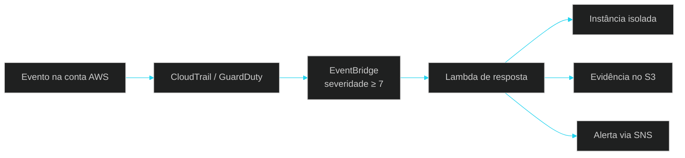

</details>


<div align="center">


<br/>

| Categoria | Tecnologias |
|:---|:---|
| **Cloud** |      |
| **Segurança** |     |
| **DevOps & IaC** |     |
| **Linguagens** |     |
| **Sistemas** |     |

</div>


| Objetivo | Status |
|---|---|
| AWS Certified Cloud Practitioner (CLF-C02) | 🟡 Em preparação |
| Terraform avançado (módulos) | 🟡 Em andamento |
| Kubernetes & Container Security | 🟡 Em andamento |
| Certificação em Segurança da Informação | 🟡 Em andamento |
| SentinelCloud (scanner CSPM AWS) | 🟢 Publicado |
| Java + Spring Boot com IA | 🟢 Explorando |

**Construindo agora:** automações de governança e FinOps na AWS e pipelines CI/CD seguros.


<div align="center">

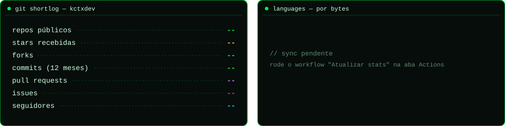

<br/>


<br/><br/>


</div>

<!-- WhatsApp: descomente apenas se quiser expor seu número publicamente
[](https://wa.me/5511959445413)
-->
