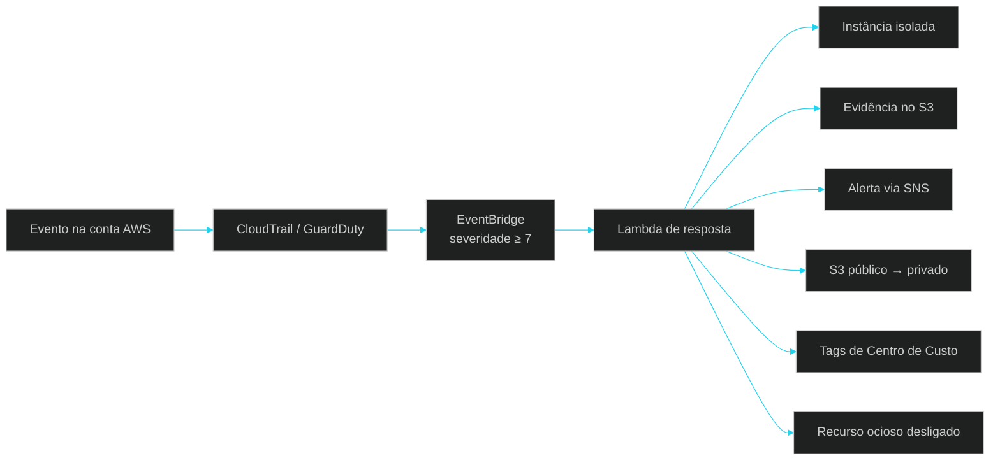

<div align="center">


<br/>


[](https://www.linkedin.com/in/SEU-USUARIO)
[](mailto:johnataichigo56@gmail.com)
[](https://johnataa.vercel.app)




</div>


## `root@kctxdev:~# cat /etc/sobre.conf`

```text
┌──(root㉿kctxdev)-[~]
└─# cat /etc/motd
   "Segurança não é um recurso. É a fundação."
   // mantenha o menor privilégio. assuma o vazamento. automatize a resposta.
```

Projeto e automatizo infraestrutura em nuvem em que **segurança, auditoria e custo são requisitos de arquitetura**, aplicando *Security by Design* e *Least Privilege* desde o primeiro commit.

```yaml
nome:        Johnata Williamy Sousa da Silva
cargo:       Analista Júnior em Cloud & DevSecOps
foco:        Cloud Security · IaC · CI/CD seguro · FinOps
formacao:    Cursando Segurança da Informação (Técnico/Superior)
idiomas:     Português (nativo) · Inglês (intermediário)
disponivel:  PJ / CLT em Cloud & Security
```

> **English:** Cloud & DevSecOps engineer focused on secure-by-default AWS infrastructure, event-driven incident response and least-privilege CI/CD pipelines.


## `root@kctxdev:~# ./impacto --resumo`

```text
SEGURANÇA
  portas SSH expostas ........ 0      (acesso via SSM Session Manager)
  IPs públicos nas instâncias  0
  criptografia em repouso .... AES-256 (S3 e EBS) · IMDSv2 obrigatório

AUTOMAÇÃO
  deploys manuais ............ 0      (100% via GitHub Actions)
  credenciais no código ...... 0      (OIDC + Secrets Manager)
  ações automáticas/incidente  3      (isolar · coletar evidência · alertar)
  módulos Terraform .......... 6      (2 ambientes: dev e prod)

GOVERNANÇA
  auditoria de API ........... 100%   (CloudTrail multi-região)
  bloqueio de acesso público S3 100%
  alerta de custo ............ a partir de US$ 10
```


## `root@kctxdev:~# ls -la ./projetos/`

### 🛰️ CloudGuard — Detecção, Resposta a Incidentes & FinOps
[Repositório](https://github.com/kctxdev/cloudguard-aws-security) · `Terraform` `GuardDuty` `EventBridge` `Lambda (Python)` `CloudTrail` `SNS` `SSM`

| | |
|---|---|
| **Problema** | Resposta manual a ameaças é lenta e inconsistente, e recursos ociosos geram custo silencioso. |
| **Solução** | Plataforma orientada a eventos que detecta, contém e remedia riscos de segurança e de custo automaticamente. |
| **Resultado** | Para ameaças de severidade ≥ 7: isola a instância, preserva o finding no S3 como evidência forense e alerta o time via SNS. Também remedia buckets S3 públicos, aplica tags de Centro de Custo e desliga recursos ociosos. |

<details>
<summary><b>Ver arquitetura</b></summary>



</details>

### 🔐 Pipeline CI/CD DevSecOps
[Repositório](https://github.com/kctxdev/aws-cicd-devsecops) · `GitHub Actions` `Terraform` `Secrets Manager` `IAM`

| | |
|---|---|
| **Problema** | Chaves estáticas em código ou em secrets de CI são um vetor recorrente de vazamento. |
| **Solução** | Esteira com IaC de menor privilégio, segredos no Secrets Manager (sa-east-1) e deploy automático a cada push. |
| **Resultado** | 0 credenciais no código, 0 deploys manuais e `terraform fmt` obrigatório para o pipeline concluir. |

### 🌐 AWS Secure VPC · 📊 AWS Monitoramento
[aws-secure-vpc-terraform](https://github.com/kctxdev/aws-secure-vpc-terraform) · [aws-monitoramento-terraform](https://github.com/kctxdev/aws-monitoramento-terraform)

- **Baseline de rede e storage:** VPC com sub-redes, route tables, Internet Gateway e Security Group restrito; S3 com AES-256, versionamento e bloqueio total de acesso público.
- **Auditoria e custo:** CloudTrail com 100% das chamadas de API registradas, bucket de logs com política restrita (só o CloudTrail grava) e alarme de billing em US$ 10 com e-mail via SNS.

### 🤖 Caçador de Vagas Pro · 🎙️ Finance AI Voice API
- [cacador-de-vagas-bot](https://github.com/kctxdev/cacador-de-vagas-bot) · `Python` `BeautifulSoup4` `SQLite`: agrega vagas de 5+ sites em paralelo, com filtro por título, geolocalização via IP e cache de 30 min para respostas instantâneas.
- **Finance AI Voice API** · `Java` `Spring Boot` `Spring AI`: orçamento financeiro por comando de voz, com transcrição, *Tool Calling* e resposta em áudio.

<!-- Descomente e coloque o link real do repositório:
[Finance AI Voice API](https://github.com/kctxdev/NOME-DO-REPO)
-->


## `root@kctxdev:~# nmap -sV stack`

<div align="center">


<br/>

| Categoria | Tecnologias |
|:---|:---|
| **Cloud** |      |
| **Segurança** |     |
| **DevOps & IaC** |     |
| **Linguagens** |     |
| **Sistemas** |     |

</div>


## `root@kctxdev:~# tail -f /var/log/andamento.log`

| Objetivo | Status |
|---|---|
| AWS Certified Cloud Practitioner (CLF-C02) | 🟡 Em preparação |
| Terraform avançado (módulos) | 🟡 Em andamento |
| Kubernetes & Container Security | 🟡 Em andamento |
| Certificação em Segurança da Informação | 🟡 Em andamento |
| Java + Spring Boot com IA | 🟢 Explorando |

**Construindo agora:** automações de governança e FinOps na AWS e pipelines CI/CD seguros.


## `root@kctxdev:~# git log --graph --all`

<div align="center">


<br/><br/>

<picture>
  <source media="(prefers-color-scheme: dark)" srcset="https://raw.githubusercontent.com/kctxdev/kctxdev/output/github-contribution-grid-snake-dark.svg" />
  <source media="(prefers-color-scheme: light)" srcset="https://raw.githubusercontent.com/kctxdev/kctxdev/output/github-contribution-grid-snake.svg" />
  
</picture>

<br/><br/>


</div>

<!-- WhatsApp: descomente apenas se quiser expor seu número publicamente
[](https://wa.me/5511959445413)
-->
